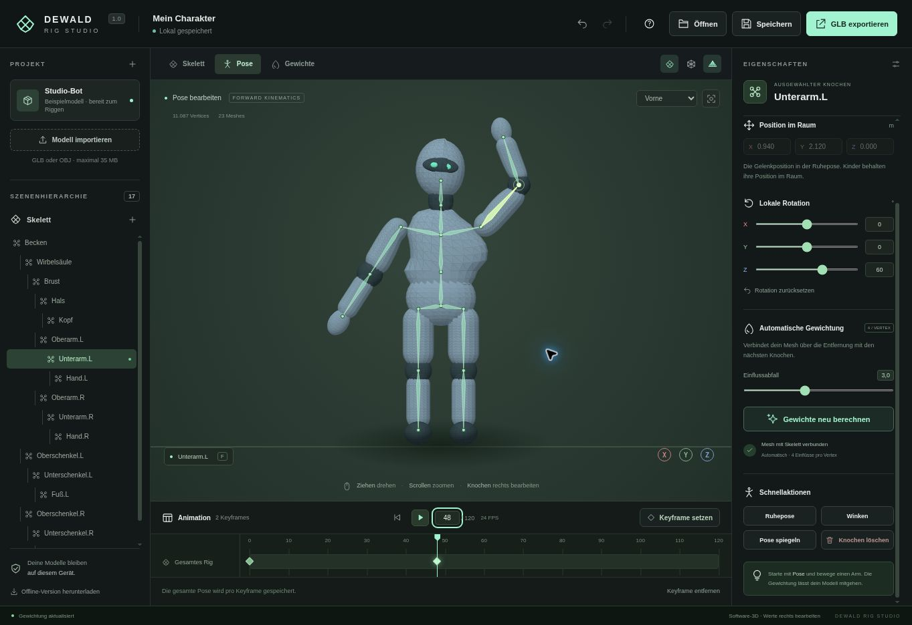

# Dewald Rig Studio

3D-Rigging im Browser: ein Modell laden, Knochen anpassen und eine kurze Animation erstellen. Die Modelldaten bleiben auf dem eigenen Gerät.



## Starten

[Live-Demo öffnen](https://michi992.github.io/Rigg/)

Repository über **Code → Download ZIP** herunterladen und entpacken. Anschließend die Datei **dist/dewald-rig-studio.html** öffnen. Für diese Version sind weder Node.js noch eine Internetverbindung nötig.

Zum Ausprobieren ist ein Beispielmodell vorhanden. Eigene Modelle lassen sich als unkomprimierte GLB- oder OBJ-Datei laden. Für das Humanoid-Skelett eignet sich eine T-Pose mit Blickrichtung +Z.

## Arbeiten mit dem Editor

1. Unter **Skelett** Gelenke auswählen und ihre Position an das Modell anpassen. Mit **+** wird ein Kindknochen angelegt.
2. Unter **Pose** die lokalen Rotationen ändern. **Gewichte** zeigt den Einfluss des ausgewählten Knochens.
3. Einen Frame wählen und **Keyframe setzen** drücken. Für eine Bewegung mindestens zwei verschiedene Frames belegen.
4. **Speichern** erstellt eine bearbeitbare .rig.json-Datei. **GLB exportieren** gibt Modell, Rig und gesetzte Animation aus. Ohne Keyframes wird die Ruhepose exportiert.

Strg+S speichert das Projekt, Strg+Z/Y geht zurück/vor, F zentriert die Ansicht, die Leertaste startet oder stoppt die Vorschau. Die Browsersicherung ersetzt keine eigene Projektdatei.

## Einschränkungen

Die Gewichtung beruht auf Knochenabständen und kann an schwierigen Gelenken Nacharbeit benötigen. Weight Painting und IK sind noch nicht enthalten. Der Import normalisiert Modelle auf 3 m Höhe und ersetzt vorhandene Rigs und Animationen; Morph-Ziele werden nicht übernommen.

<!-- limits:start -->

| Einstellung  | Wert                   |
| ------------ | ---------------------- |
| Modellimport | 35 MB                  |
| Projektdatei | 50 MB                  |
| Vertices     | 300.000                |
| Knochen      | 100                    |
| Zeitleiste   | Frame 0–120 bei 24 FPS |

<!-- limits:end -->

Die Werte werden beim Build aus `src/config.js` übernommen. Externe OBJ-Materialdateien sowie Draco-, Meshopt- und KTX2-Kompression werden nicht geladen. Ohne WebGL 2 gibt es eine vereinfachte Softwareansicht; Knochen werden dort über die Wertefelder bearbeitet.

## Entwicklung

Node.js ab Version 18; die automatische Prüfung verwendet Node.js 24:

```sh
npm ci
npm run check
npm test
npm run format:check
npm run build
```

Mit `npm run format` wird der Quellcode formatiert. Der Build erstellt die Webversion und die einzelne Offline-HTML-Datei unter `dist/`. Dieser Ordner bleibt bewusst eingecheckt, damit der ZIP-Download sofort nutzbar ist. Nach Änderungen am Quellcode deshalb auch den Build aktualisieren.

| Datei / Ordner                | Aufgabe                                                          |
| ----------------------------- | ---------------------------------------------------------------- |
| `src/app.js`, `src/editor.js` | Einstieg, Editorbefehle und Zusammenspiel der Module             |
| `src/viewport.js`             | Three.js-Szene, Kameras, Auswahl und Transformationswerkzeug     |
| `src/ui/`                     | Baumansicht, Inspector, Zeitleiste, Rückmeldungen und Ereignisse |
| `src/state/`                  | Undo/Redo, Keyframes und Browsersicherung                        |
| `src/input/`                  | Dateieingabe und Tastenkürzel                                    |
| `src/rig-core.js`             | Skelett, Gewichtung, Verformung und Animation                    |
| `src/project-files.js`        | Projektformat, Validierung und Modellparser                      |
| `src/config.js`               | Gemeinsame Limits und Animationsparameter                        |
| `src/software-renderer.js`    | Canvas-Ansicht als Ersatz für WebGL                              |

Die Tests prüfen unter anderem Verformung und GLB-Rückimport, Undo/Redo, Keyframe-Verwaltung, UI-Auswahl, Tastenkürzel sowie beschädigte und zu große Dateien. Importierte Namen werden in der Oberfläche als Text eingesetzt.

Der Workflow in `.github/workflows/ci.yml` führt bei jedem Push und Pull Request Syntaxprüfung, Tests, Formatprüfung und Build aus. Er prüft außerdem, ob `dist/` und die generierten README-Werte aktuell sind. Auf `main` wird der geprüfte Build über GitHub Pages veröffentlicht.

## Lizenz

Der Projektcode steht unter der [MIT-Lizenz](LICENSE). Three.js wird ebenfalls unter der MIT-Lizenz verwendet; dessen eigener Lizenztext bleibt in `dist/THREE-LICENSE.txt` erhalten. Beide Lizenztexte sind auch in der Offline-Datei enthalten.
