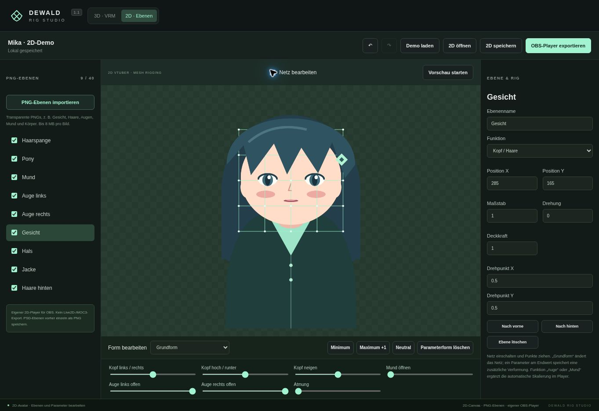

# Dewald Rig Studio

VTuber-Rigging im Browser: 3D-Modelle mit Humanoid-Rig und Gesichtsformen als VRM 1.0 exportieren oder gezeichnete 2D-Avatare aus PNG-Ebenen riggen. Die Modelldaten bleiben auf dem eigenen Gerät.


## Starten

[Live-Demo öffnen](https://michi992.github.io/Rigg/)

Repository über **Code → Download ZIP** herunterladen und entpacken. Anschließend die Datei **dist/dewald-rig-studio.html** öffnen. Für diese Version sind weder Node.js noch eine Internetverbindung nötig.

Oben zwischen **3D · VRM** und **2D · Ebenen** wechseln. Beide Bereiche haben eine eigene Browsersicherung und Undo/Redo. Beispielmodelle sind enthalten.

## 3D-VTuber

Unkomprimierte GLB-, OBJ- oder VRM-1.0-Datei importieren. Für das Humanoid-Skelett eine T-Pose mit Blickrichtung +Z verwenden.

1. Das Skelett an das Modell anpassen und die Gewichtung prüfen.
2. **VTuber / VRM** öffnen, Avatarname und den tatsächlichen Modellautor eintragen.
3. Unter **Knochenzuordnung bearbeiten** die Humanoid-Knochen zuordnen. Fehlende Pflichtknochen und ungültige Ketten verhindern den Export.
4. Vorhandene Morph Targets für Blinzeln, Vokale und Ausdrücke zuordnen. Mit den Vorschau-Reglern testen. Der Studio-Bot enthält Blinzeln und Mundöffnung zum Ausprobieren.
5. **VRM exportieren** erstellt eine VRM-1.0-Datei mit neutraler Pose und den gespeicherten Gesichtszuordnungen. In einer App laden, die VRM 1.0 unterstützt; die Ziel-App übernimmt das Tracking.

Gesichtsformen bleiben beim Modellimport erhalten. Neue Formen werden hier nicht modelliert; sie müssen im GLB bereits vorhanden sein. Beim VRM-Import werden unterstützte Humanoid- und Gesichtszuordnungen sowie Metadaten übernommen. Das Rig und seine Gewichte werden neu aufgebaut. Zusätzliche Fingerknochen, Spring Bones, Constraints und MToon-spezifische Materialeigenschaften werden nicht übernommen. VRM 0.x vorher in einem geeigneten Editor in VRM 1.0 konvertieren.

## 2D-VTuber



1. **2D · Ebenen** wählen. Eine Demo mit separaten Augen, Mund, Haaren, Gesicht und Körper ist vorhanden.
2. Über **PNG-Ebenen importieren** eigene transparente PNGs hinzufügen. PSD-Ebenen vorher einzeln als PNG exportieren. Größe, Position, Drehpunkt, Reihenfolge und Deckkraft rechts einstellen.
3. Einer Ebene die Funktion **Kopf / Haare**, **Körper**, **Auge links/rechts** oder **Mund** zuweisen. Der Player verbindet diese mit seinen Kopf-, Blink-, Atem- und Mundparametern.
4. **Netz bearbeiten** einschalten. Unter **Grundform** Netzpunkte verschieben. Für eine Parameterform den Parameter wählen, **Minimum** oder **Maximum +1** drücken und die Punkte am Endwert verschieben. Die Regler interpolieren zwischen den Formen. **Neutral** setzt die Vorschau zurück.
5. Mit **2D speichern** eine bearbeitbare `.vtuber2d.json` sichern. **OBS-Player exportieren** erstellt eine einzelne HTML-Datei mit den Bildern, Formen und dem Player.

Den Player in OBS als lokale Browserquelle hinzufügen und die Bedienung ausblenden. Er bietet automatisches Blinzeln und Atmen, Kopfbewegung über die Maus und optional Mundöffnung über Mikrofonlautstärke. Für die Mikrofonfunktion die Datei in einem Browser mit Mikrofonfreigabe öffnen; Verfügbarkeit in eingebetteten OBS-Browsern hängt von deren Freigaben ab. Mikrofonzugriff beginnt erst nach dem Einschalten und endet beim Ausschalten oder Schließen. Es werden keine Audioaufnahmen gespeichert.

Das ist ein eigenes 2D-Format und **kein Live2D-/MOC3-Export**. Der Player hat keine Webcam-Gesichtsverfolgung und keine Haarphysik. Für VTube Studio/Cubism ist weiterhin ein kompatibles Live2D-Modell erforderlich; eine `.vtuber2d.json` lässt sich dort nicht direkt laden.

## Arbeiten mit dem Editor

1. Unter **Skelett** Gelenke auswählen und ihre Position an das Modell anpassen. Mit **+** wird ein Kindknochen angelegt.
2. Unter **Pose** die lokalen Rotationen ändern. **Gewichte** zeigt den Einfluss des ausgewählten Knochens.
3. Einen Frame wählen und **Keyframe setzen** drücken. Für eine Bewegung mindestens zwei verschiedene Frames belegen.
4. **Speichern** erstellt eine bearbeitbare .rig.json-Datei. **GLB exportieren** gibt Modell, Rig und gesetzte Animation aus. Ohne Keyframes wird die Ruhepose exportiert.

Strg+S speichert das Projekt, Strg+Z/Y geht zurück/vor, F zentriert die Ansicht, die Leertaste startet oder stoppt die Vorschau. Die Browsersicherung ersetzt keine eigene Projektdatei.

## Einschränkungen

Die 3D-Gewichtung beruht auf Knochenabständen und kann an schwierigen Gelenken Nacharbeit benötigen. Weight Painting und IK sind noch nicht enthalten. Der Import normalisiert Modelle auf 3 m Höhe und ersetzt vorhandene Rigs und Animationen. Morph-Ziele für Positionen bleiben erhalten; Morph-Normalen werden nicht übernommen.

<!-- limits:start -->

| Einstellung     | Wert                   |
| --------------- | ---------------------- |
| Modellimport    | 35 MB                  |
| Projektdatei    | 50 MB                  |
| Vertices        | 300.000                |
| Knochen         | 100                    |
| Zeitleiste      | Frame 0–120 bei 24 FPS |
| 2D-Ebenen       | 40                     |
| PNG pro Ebene   | 8 MB                   |
| PNG-Abmessungen | 4096 × 4096 Pixel      |

<!-- limits:end -->

Die Werte werden beim Build aus `src/config.js` übernommen. Externe OBJ-Materialdateien sowie Draco-, Meshopt- und KTX2-Kompression werden nicht geladen. Ohne WebGL 2 gibt es eine vereinfachte Softwareansicht; Knochen werden dort über die Wertefelder bearbeitet.

## Entwicklung

Node.js ab Version 18; die automatische Prüfung verwendet Node.js 24:

```sh
npm ci
npm run check
npm test
npm run format:check
npm run build
```

Mit `npm run format` wird der Quellcode formatiert. Der Build erstellt die Webversion und die einzelne Offline-HTML-Datei unter `dist/`. Dieser Ordner bleibt bewusst eingecheckt, damit der ZIP-Download sofort nutzbar ist. Nach Änderungen am Quellcode deshalb auch den Build aktualisieren.

| Datei / Ordner                | Aufgabe                                                          |
| ----------------------------- | ---------------------------------------------------------------- |
| `src/app.js`, `src/editor.js` | Einstieg, Editorbefehle und Zusammenspiel der Module             |
| `src/viewport.js`             | Three.js-Szene, Kameras, Auswahl und Transformationswerkzeug     |
| `src/ui/`                     | Baumansicht, Inspector, Zeitleiste, Rückmeldungen und Ereignisse |
| `src/state/`                  | Undo/Redo, Keyframes und Browsersicherung                        |
| `src/input/`                  | Dateieingabe und Tastenkürzel                                    |
| `src/rig-core.js`             | Skelett, Gewichtung, Verformung und Animation                    |
| `src/project-files.js`        | Projektformat, Validierung und Modellparser                      |
| `src/config.js`               | Gemeinsame Limits und Animationsparameter                        |
| `src/software-renderer.js`    | Canvas-Ansicht als Ersatz für WebGL                              |
| `src/vtuber/`                 | Humanoid-Zuordnung, Gesichtsformen und VRM-Export                |
| `src/twod/`                   | 2D-Ebenen, Parameterformen, Netz-Renderer und OBS-Player         |

Die Tests prüfen unter anderem Verformung und GLB-Rückimport, Undo/Redo, Keyframe-Verwaltung, UI-Auswahl, Tastenkürzel sowie beschädigte und zu große Dateien. Der VRM-Export wird mit `@pixiv/three-vrm` wieder geladen. Für 2D werden Parameterformen, PNG-Validierung, Transformationen und der minifizierte Player samt Mikrofon-Lebenszyklus geprüft. Importierte Namen werden in der Oberfläche als Text eingesetzt.

Der Workflow in `.github/workflows/ci.yml` führt bei jedem Push und Pull Request Syntaxprüfung, Tests, Formatprüfung und Build aus. Er prüft außerdem, ob `dist/` und die generierten README-Werte aktuell sind. Auf `main` wird der geprüfte Build über GitHub Pages veröffentlicht.

## Lizenz

Der Projektcode steht unter der [MIT-Lizenz](LICENSE). Three.js wird ebenfalls unter der MIT-Lizenz verwendet; dessen eigener Lizenztext bleibt in `dist/THREE-LICENSE.txt` erhalten. Beide Lizenztexte sind auch in der Offline-Datei enthalten.
